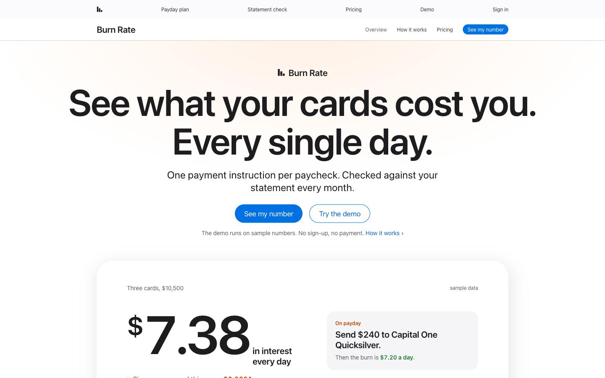
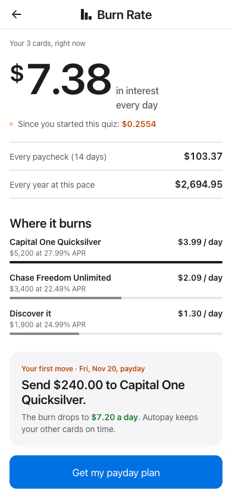
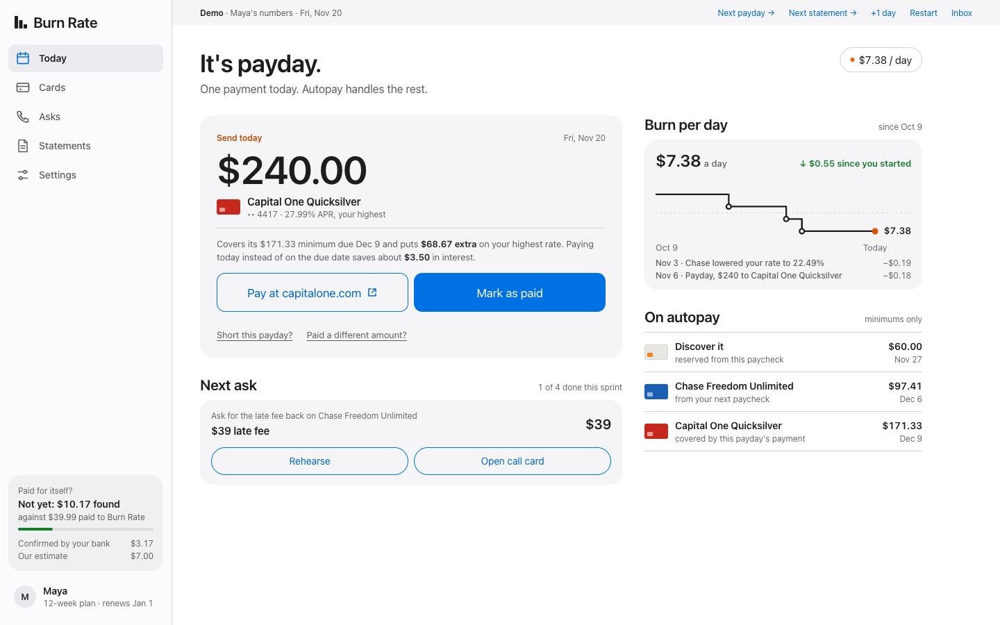
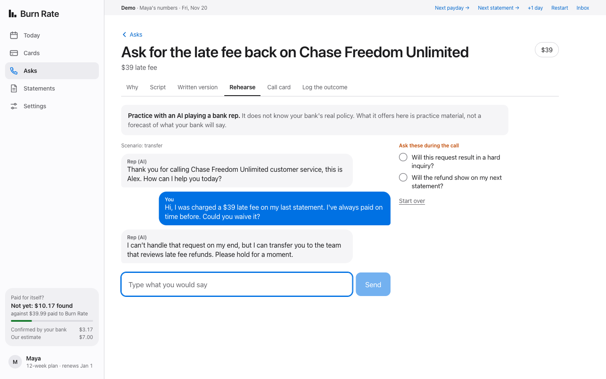
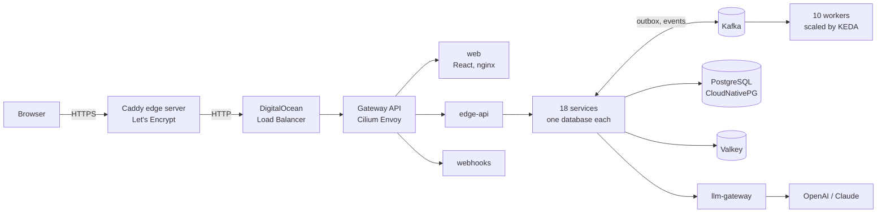

# Burn Rate

**See what your credit cards cost you. Every single day.**

Burn Rate is a payday plan for Americans who carry credit-card balances. It turns three or four cards into one number, what the interest costs per day, and then on every payday it gives one instruction: this amount, to this card, today.

**Live:** https://burnrate.67.207.94.96.sslip.io &nbsp;·&nbsp; no sign-up, press **Try the demo** &nbsp;·&nbsp; test card `4242 4242 4242 4242`



| Your number before any price | One instruction on payday | Practice the call with an AI bank rep |
|---|---|---|
|  |  |  |

---

## The problem

About 111 million Americans don't pay their card in full each month. The average APR is around 22%. Interest is charged daily, but people see it only once a month, as one line on a statement. So they lose money in three places:

- **The wrong card.** Extra money goes to the smallest or the most annoying balance, not the most expensive one.
- **The wrong day.** Paying on the due date instead of payday leaves the balance on the card longer. Autopay at the minimum quietly replaces bigger payments.
- **Never asking.** Most people never call to ask for a lower rate or a late-fee refund. Of those who do, most get something.

Maya, our reference user, has three cards and $10,500 of balance. That costs her **$7.38 a day**, or $2,695 a year.

## What the product does

| Rhythm | What happens | Where in the code |
|---|---|---|
| **First 14 days: the asks** | A short list of requests to her issuers: lower rate, late-fee refund, annual fee, due-date move. Each one comes with a script built from her numbers, a call card to tap through during the call, a practice call with an AI playing the bank rep, and an outcome log. | `services/asks.py`, `services/rehearsal.py` |
| **Every payday: one amount, one card** | Minimums stay on autopay as a safety net. Everything above them goes to one card, on the day the paycheck lands. Short paycheck, a different amount, undo: all handled. | `engine/plan.py`, `services/plan.py` |
| **Every statement: a check** | She uploads or pastes the statement. The model reads it, arithmetic checks it, and our forecast is set next to the bank's number with the difference explained. Then the ledger is corrected to the bank's figure. | `services/statements.py`, `engine/checks.py` |

Two more things run all the time:
- **The burn chart** moves only on real events: a payment, a lower rate, a new charge.
- **The paid-for-itself meter** compares what she found with what she paid us. It shows the number even when it is negative.

**Burn Rate never moves money and never contacts a bank.** She makes every payment and every call herself. It is planning software, not debt relief or credit repair, and a guard service blocks wording that would say otherwise.

## Try it in two minutes

1. Open the [live link](https://burnrate.67.207.94.96.sslip.io) and press **Try the demo**. You are Maya, on a payday.
2. The demo bar at the top moves time: **Next payday**, **Next statement**, **+1 day**. **Inbox** shows the texts and emails she would get.
3. **Asks** → pick one → **Rehearse**. The bank rep is a live model.
4. **Statements**: after **Next statement**, open the new statement to see the forecast checked against the bank's number.
5. For the paid path, open the site in a private window and press **See my number**. Answer the quiz, use the sample numbers, pick a plan and pay with `4242 4242 4242 4242`, any future date, any CVC.

## How it works

### Our code computes. The model explains.

Every number on screen comes from a deterministic engine (`burnrate/engine`), not from a language model.

- **Interest is computed the way issuers compute it:** daily balance, APR ÷ 365, compounded daily.
  - Money is kept in integer cents and rates in basis points. Intermediate math uses exact fractions.
  - Golden test: $5,000 at 24% for 30 days is exactly **$99.58**.
- **Minimum-payment formulas are data.** There are rules for Chase, Discover, Capital One, Citi, Amex, Bank of America, Wells Fargo and a generic one.
- **The planner** (`engine/plan.py`) splits a paycheck across due dates and paydays. It reserves minimums from the right paycheck and sends the rest to the most expensive card.
- **The ledger is a sum of dated events.** When a statement arrives, the forecast is reconciled against it. The gap is explained as unplanned purchases, payments on other days, a rate change, or rounding, and then the balance is set to the bank's number.
- **Refinance math** covers balance transfers and consolidation loans.

The model has two jobs:
- **It reads statements.** It copies figures as printed, then code converts them and checks the statement's own arithmetic before anything is saved.
- **It plays the bank rep** in practice calls. Its replies are checked against 12 wording rules while they stream.

OpenAI `gpt-5.4-mini` is the default model and Claude can be switched on. Daily spend caps apply per deployment, per user and per guest. Tests use a fake provider and make no paid calls.

### Architecture



- **One image for everything.** The role is chosen by the `SERVICE` variable: a service, a worker, a loop or a job.
- **Each service owns its database**, and services never read each other's tables. They talk through internal HTTP with a service token, and through events.
- **Events go through a transactional outbox to Kafka.** Consumers are idempotent, so a replayed event changes nothing.
- **The request context travels with every call**: user, demo flag, demo clock offset, time zone, request id. That is how the demo clock moves time for one visitor without touching anyone else.
- **`BR_MODE=local` runs all services in one process** on SQLite with an in-process event bus. The same code, used for development and tests.

| Service | Owns |
|---|---|
| `edge-api` | the public API ([docs/API.md](docs/API.md)), sessions, rate limits |
| `webhooks` | Stripe and SMS webhooks, signature checks |
| `identity` | users, guest sessions, sign-in links |
| `funnel` | quiz answers, the result, adoption after payment |
| `cards` | cards and the event ledger |
| `engine` | the calculation engine as a service |
| `plan` | payday instructions, schedule, burn history, meter |
| `statements` | upload, reading, checks, reconciliation |
| `asks` | the asks queue, scripts, call cards, outcomes, issuer playbook |
| `rehearsal` | practice calls |
| `llm-gateway` | model providers, budgets, structured extraction |
| `guard` | wording rules for anything shown to the user |
| `billing` | plans, checkout, renewals, pause, cancel, refund |
| `notifications` | text and email templates, inbox, preferences |
| `scheduler` | timers: payday morning, statement expected, renewal notice |
| `analytics-api` | first-party product events |
| `demo` | the demo persona and the demo clock |
| `backoffice` | admin overview, LLM spend, rules, playbook |

Workers: `onboarding`, `plan-events`, `plan-recalc`, `statement-extractor`, `reconciler`, `asks-events`, `playbook-aggregator`, `notifier`, `billing-events`, `analytics-sink`. There is also one loop, `timer-dispatcher`.

### In production

The product runs on DigitalOcean Kubernetes (DOKS 1.35):
- **Cluster:** 2 nodes of 4 vCPU and 8 GB.
- **Data:** Strimzi Kafka 4.3, CloudNativePG with PostgreSQL 17, Valkey.
- **Scaling:** KEDA scales workers on consumer lag; HPA and metrics-server scale the online services.
- **Monitoring:** kube-prometheus-stack.
- **Network:** default-deny NetworkPolicies.
- **Entry:** the Gateway API with Cilium, behind a Caddy edge server that holds the certificate.

The profile is chosen to fit two nodes. A full profile with Linkerd, Vault, Argo CD, Loki and Tempo, and three Kafka brokers is written and validated, but not installed; it needs about six nodes. Everything is in [deploy/README.md](deploy/README.md): scripts, memory budget, costs, and what was and was not verified.

Checked on the live deployment:
- the smoke test passes all 7 checks, and internal paths answer 404 from outside;
- full journeys work in a browser, both the paid path and the demo;
- under load it serves 35 requests per second at p95 355 ms.

## Tests

```bash
make test          # everything below
```

| Suite | Tests | What it covers |
|---|---|---|
| `tests/engine` | 49 | interest, minimums, payday plans, projections, refinance, statement checks (golden numbers) |
| `tests/services/test_journeys.py` | 13 | end-to-end journeys through the public API with all services: quiz → payment → plan, payday, statement, cancel, refund, access isolation |
| `tests/services/test_guard.py` | 49 | wording rules |
| `tests/services/test_llm_gateway.py` | 21 | providers, budgets, extraction, streaming, both SDKs against a mock transport |
| `tests/services/test_asks.py`, `test_rehearsal.py` | 28 | asks, scripts, outcomes, playbook, practice calls |
| `tests/services/test_cards_identity.py` | 7 | ledger and identity |
| `web` (vitest) | 53 | formatting, the payday card, paywall consent, the mock API contract |

That is 167 Python tests and 53 front-end tests. None of them calls a paid API.

## Run it locally

```bash
uv sync
cd web && npm ci && npm run build && cd ..
make dev            # everything in one process on http://localhost:8000, SQLite in .data/
```

For the cluster setup on a laptop (PostgreSQL, Kafka, Valkey), run `make compose-up`. To deploy: `make build deploy smoke` (see [deploy/README.md](deploy/README.md)).

## Repository

```
burnrate/
  engine/        interest, plans, projections, refinance, statement checks
  services/      18 services (one module each), event handlers inside the owning service
  common/        config, request context, outbox and bus, internal clients, auth, guardrails, LLM adapters
web/             React, Vite, TypeScript front end (also a mock mode: npm run dev:mock)
tests/           engine golden tests, service and journey tests
deploy/          Kubernetes manifests (small and full profiles), platform values, scripts, edge server config
docs/API.md      the public API contract
tools/loadtest.py
```

## Known limits

- Payments run in test mode through our own form. A Stripe test-mode integration exists in `services/billing.py` but is not switched on in production.
- The Claude provider is covered by tests against the SDK, but has not been called live.
- With two nodes, losing one takes part of the system down.
- The hop from the edge server to the load balancer is plain HTTP.
- When a temporary rate reduction expires, the rate is not restored automatically.
